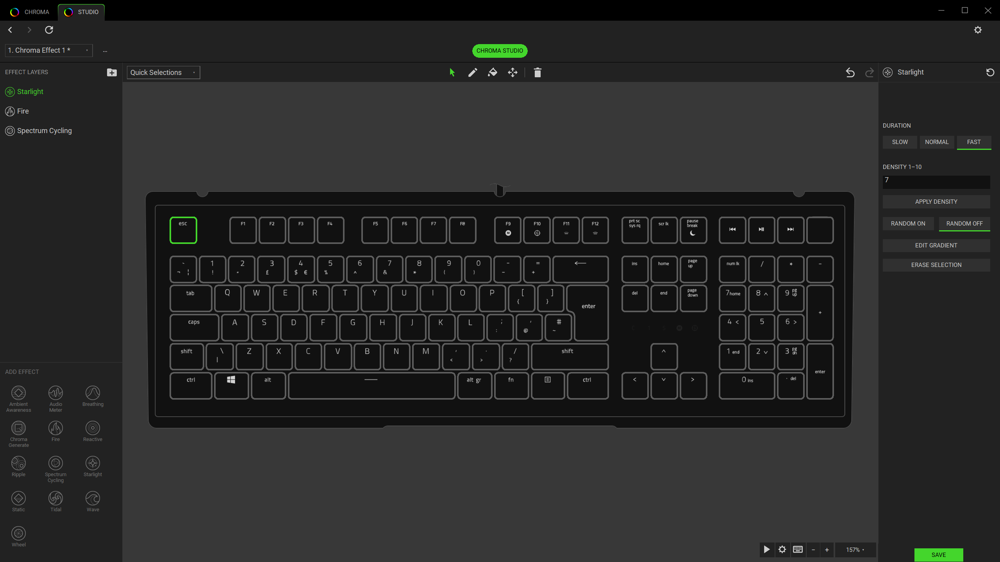
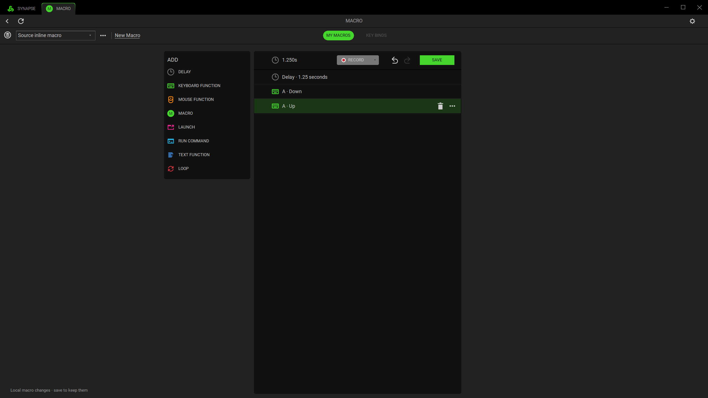

<p align="center"></p>

<p align="center">
  <a href="https://github.com/mitchellrevill/synapse-lite/actions/workflows/ci.yml">Build status</a> ·
  <a href="docs/development.md">Build from source</a> ·
  <a href="docs/cli.md">CLI reference</a> ·
  <a href="docs/compatibility.md">Compatibility</a> ·
  <a href="https://github.com/mitchellrevill/synapse-lite/issues">Report an issue</a>
</p>

A native Rust peripheral manager with familiar Synapse controls, local profiles and a lighting editor. No advertising, accounts or telemetry in the native app.

Built on [Secretarybird](https://github.com/infinityInfinite/secbird). The existing `secbird` CLI, commands and profile tooling are retained.

> **In development.** Device support varies by model and firmware. Some Studio effects and input features are still incomplete. Complete Synapse parity and the final memory target have not been established.

## What it does

- **Device controls:** sensitivity, polling, power, lighting and supported button assignments.
- **Profiles:** local storage, application links, native backup and supported Synapse 4 interchange. Unknown imported fields are retained where supported.
- **Macros:** a local library, recording, event editing and device-dependent playback paths.
- **Studio:** LED selection, layers, gradients, composition import/export, preview and supported device output.
- **Tray and CLI:** quick profile access and the same `secbird` tooling for scripts and terminal use.

Studio currently renders Static, Spectrum Cycling, Fire, continuous Breathing, cardinal Wave, Wheel and Starlight. Other effect tiles do not yet imply working animation. See [Studio status](docs/studio.md).

## Screenshots





These are captures of the native app using an isolated editor session and simulated transport. They show the interface, not proof of support for every pictured control or physical device. [Screenshot details](docs/screenshots/README.md).

## Get started

Windows 10/11 is the native desktop target. Linux supports the CLI; the native editor is Windows-only.

Build with stable Rust and the Windows MSVC toolchain:

```powershell
cargo build --release --locked
.	arget
elease\secbird-tray.exe
```

The new logo is embedded. Device artwork, fonts and source-derived control assets are provisioned separately from local inputs; a source build does not include those vendor assets. See [asset setup](docs/assets.md) before expecting the complete interface.

Configuration lives in `%APPDATA%\SynapseLite`. Set `SYNAPSE_LITE_CONFIG_DIR` for a separate portable or test configuration. Keep the executable beside its provisioned `assets` directory, or select it with `SYNAPSE_LITE_ASSETS`.

## Same command line

```powershell
secbird list
secbird -d DEVICE_ID info
secbird -d DEVICE_ID dpi 1600
secbird export backup.json
secbird import backup.json
secbird studio inspect lighting.ChromaEffects
```

Run `secbird --help` for the complete command set. [CLI guide](docs/cli.md) covers device controls, profiles, lighting and file inspection.

## Contributing

Start with [development and tests](docs/development.md), [architecture](docs/architecture.md) and [compatibility](docs/compatibility.md). Keep changes scoped, retain input recovery, and distinguish simulator results from physical verification. Useful bug reports include the build commit, reproduction steps and a redacted `secbird report`.

The memory target is below 100 MB for both total working set and private committed memory. It is a target, not an idle-memory guarantee. [Measurement guide](docs/performance.md).

## Credits and licensing

- [infinityInfinite and Secretarybird contributors](https://github.com/infinityInfinite/secbird): the upstream Rust application, CLI and device-control foundation. This fork began at `v0.5.0-beta1` and incorporates upstream functionality through `v0.5.1`.
- [OpenRazer contributors](https://github.com/openrazer/openrazer): documented hardware and protocol facts used by the device database. No OpenRazer implementation is included.
- Synapse Lite contributors: the native interface, profile interoperability and Studio work.

Licensed under [MIT](LICENSE-MIT) or [Apache-2.0](LICENSE-APACHE). See [NOTICE](NOTICE). Razer, Synapse and Chroma are Razer trademarks. This independent project is not affiliated with or endorsed by Razer. The custom logo is project branding, not the Razer logo.
