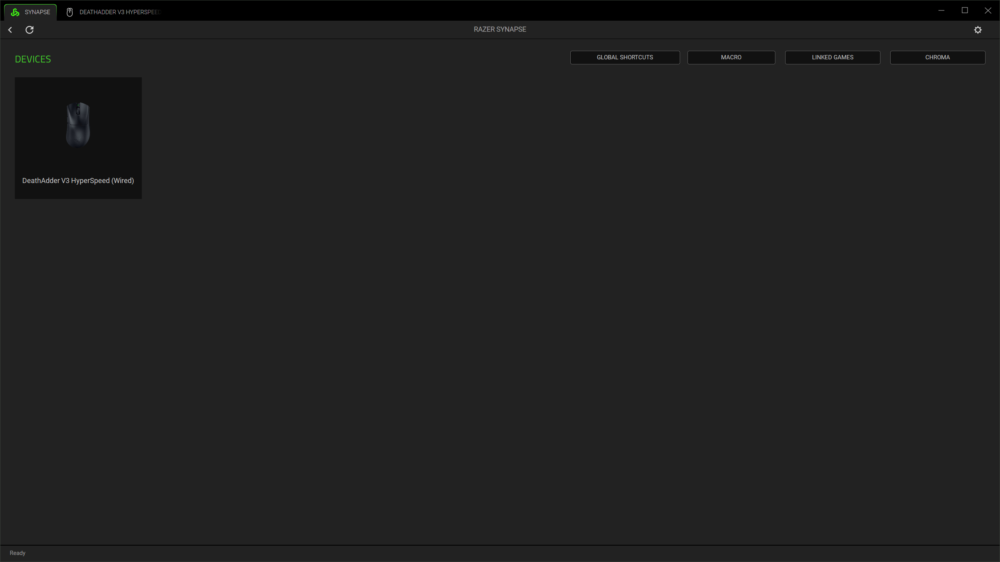
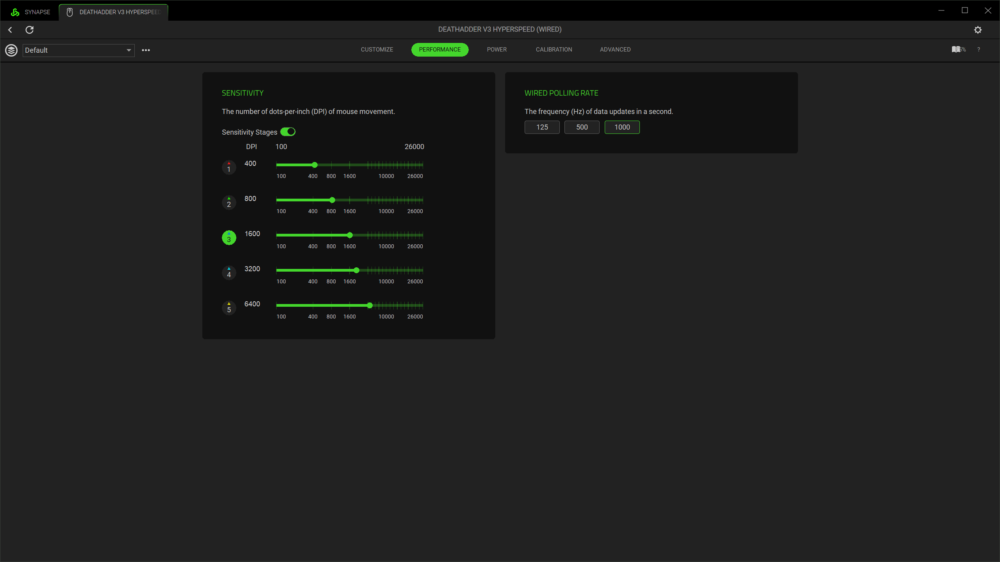
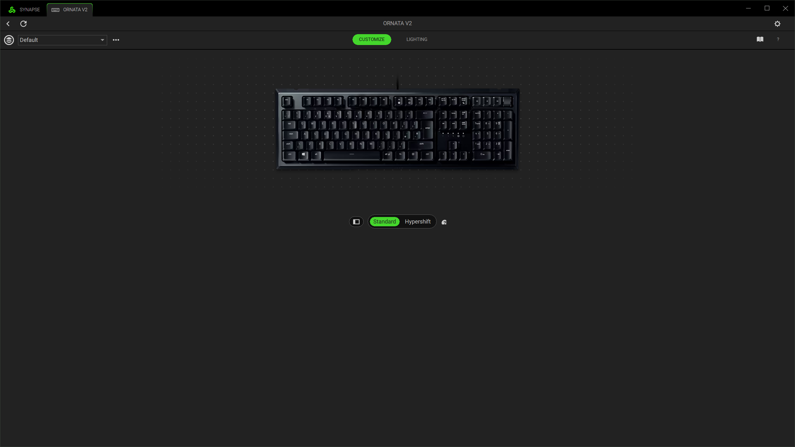
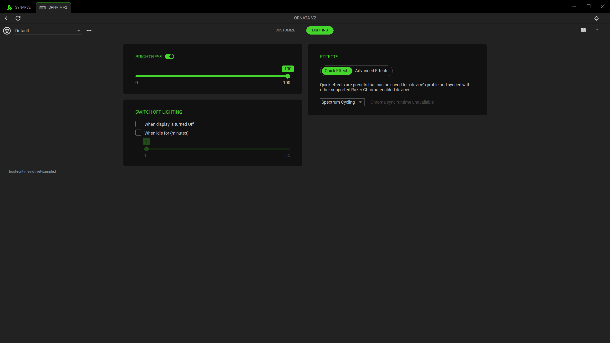
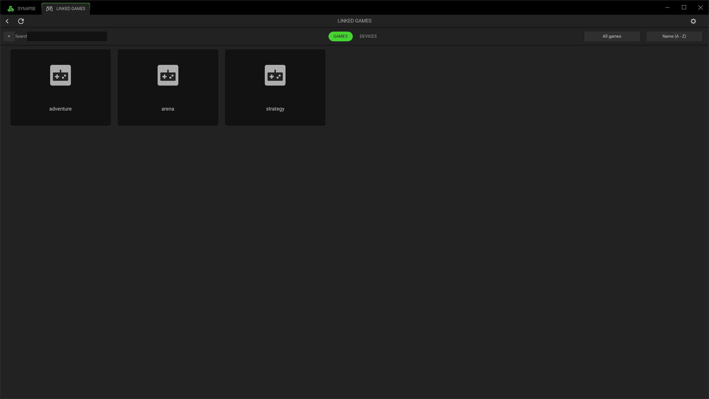
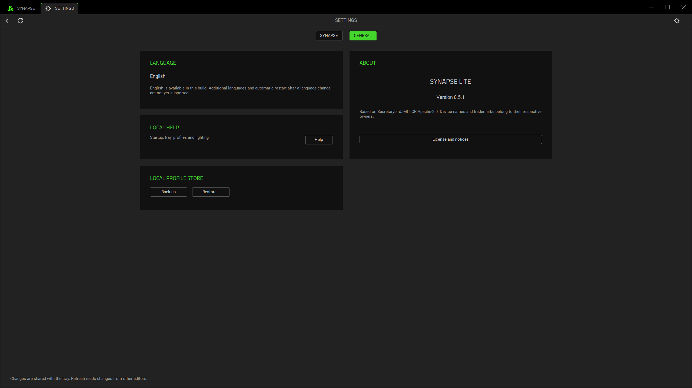

<p align="center"></p>

<p align="center">
  <a href="https://github.com/mitchellrevill/synapse-lite/actions/workflows/ci.yml">Build status</a> ·
  <a href="docs/development.md">Build guide</a> ·
  <a href="docs/cli.md">Command line</a> ·
  <a href="docs/compatibility.md">Compatibility</a> ·
  <a href="https://github.com/mitchellrevill/synapse-lite/issues">Issues</a>
</p>

A native Rust peripheral manager for Windows, with local profiles, device controls and a lighting editor. No advertising, account requirement or telemetry in the native app.

Built on [Secretarybird](https://github.com/infinityInfinite/secbird).

> **Development preview.** Support varies by device and firmware. Some lighting effects and input features are incomplete. See [compatibility](docs/compatibility.md) before replacing your existing setup.

## Features

- **Device settings:** sensitivity, polling rate, power, lighting and supported button assignments.
- **Profiles:** local storage, application links, backups and supported Synapse 4 import/export.
- **Macros:** a library, recording and event editing, with device-dependent playback support.
- **Studio:** LED selection, layers, gradients, composition files, preview and supported device output.
- **Tray and terminal:** profile access from the tray and device management with `secbird`.

Studio renders Static, Spectrum Cycling, Fire, continuous Breathing, cardinal Wave, Wheel and Starlight. Other effects and modes are still in development. [Studio capabilities](docs/studio.md).

## Screenshots

### Studio


<details>
<summary><strong>Device dashboard and controls</strong></summary>

### Dashboard



### Sensitivity



### Keyboard assignments



### Lighting



</details>

<details>
<summary><strong>Macros, linked games and preferences</strong></summary>

### Macros


### Linked games



### Preferences



</details>

Screenshots use example profiles and simulated devices. Open an image for the full 2560×1440 capture. [Gallery details](docs/screenshots/README.md).

## Build and run

The desktop app supports Windows 10/11. Linux supports the command-line tool.

For Windows, install stable Rust with the MSVC toolchain and Windows SDK:

```powershell
cargo build --release --locked
.\target\release\secbird-tray.exe
```

The desktop interface requires a separately provisioned asset pack for device artwork, fonts and source-derived controls. Those vendor assets are not included in the source repository. Follow the [asset setup guide](docs/assets.md) for a complete local build.

Settings are stored in `%APPDATA%\SynapseLite`. For portable or isolated setups, use `SYNAPSE_LITE_CONFIG_DIR`. Keep the asset pack beside the executable in an `assets` folder, or select it with `SYNAPSE_LITE_ASSETS`.

## Command line

Use `secbird` to inspect devices, adjust settings and manage profile files:

```powershell
secbird list
secbird -d DEVICE_ID info
secbird -d DEVICE_ID dpi 1600
secbird export backup.json
secbird import backup.json
secbird studio inspect lighting.ChromaEffects
```

Run `secbird --help` for all commands, or read the [CLI guide](docs/cli.md).

## Contributing

Start with [development and tests](docs/development.md) and [architecture](docs/architecture.md). Bug reports should include the build version, reproduction steps and a redacted `secbird report`.

Performance measurements and the current memory target are described in the [measurement guide](docs/performance.md). Full functional parity and final resource acceptance remain open.

## Credits and licensing

- [infinityInfinite and Secretarybird contributors](https://github.com/infinityInfinite/secbird): the Rust application, CLI and device-control foundation. This fork began at `v0.5.0-beta1` and incorporates upstream functionality through `v0.5.1`.
- [OpenRazer contributors](https://github.com/openrazer/openrazer): documented hardware and protocol facts used by the device database.
- Synapse Lite contributors: the native interface, profile interoperability and Studio work.

Licensed under [MIT](LICENSE-MIT) or [Apache-2.0](LICENSE-APACHE). See [NOTICE](NOTICE). Razer, Synapse and Chroma are Razer trademarks. This independent project is not affiliated with or endorsed by Razer.
