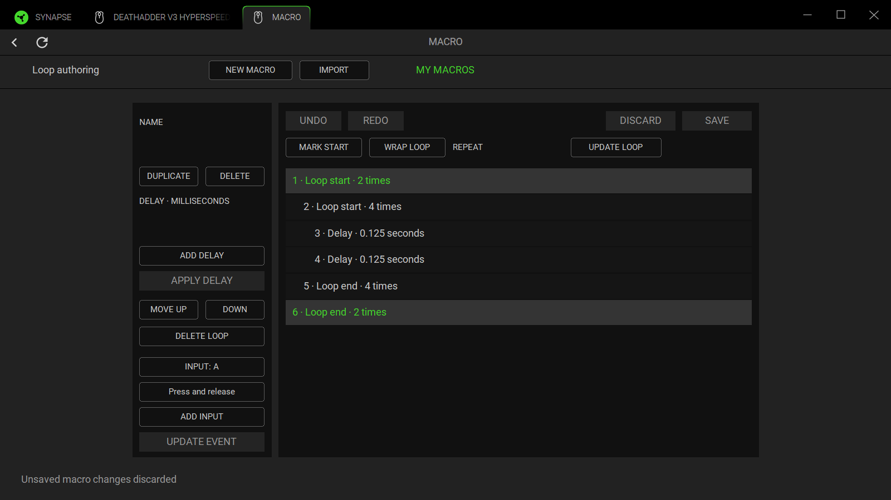

# Native macro loop drafts

The native Macro editor authors retained Type6 loop definitions. **Mark Start**
remembers the selected first row; select the last row and **Wrap Loop** to enclose
that inclusive range. Without a mark, Wrap encloses the selected row. Selecting
an existing loop boundary encloses its complete pair and body, allowing nesting.
Without a selected row, Wrap adds an empty pair at the end; select its start and
add input/delay rows to build its body. The visible row numbers are source array
indices (the retained action bar, when present, occupies hidden index 0).

**Repeat** accepts integers 1–99,999. Selecting either boundary shows the shared
repeat. **Update Loop**, Save, or changing the selection applies that count to
both boundaries; Wrap uses it for the new outer pair without changing the inner
pair. Both selected boundaries are highlighted and nested bodies are indented.
**Delete Loop** removes just the two boundaries, preserving every body row.
Undo/Redo restores exact encoded definitions, including after Save. Discard
returns to the last loaded/saved definition. No event edits reach disk until
explicit Save, which retains revision/conflict and complete-store guards.

## Verified source contract and deliberate limits

The recovered macro renderer creates two rows with Type6, the same fresh numeric
Id, Number 1, LoopEvent.State 0/1 and flag 0/1. Its template also sets selected and
isPairing false. Its C update helper changes Number on both matching IDs, while
the converter emits a start loop with repeat and an end loop without repeat.
The delete reducer removes both identified boundaries and keeps the intervening
rows. The drag reducer examines other loop IDs between the selected endpoints
and attempts to repair crossing ranges. These are static observations; the pure
create/update/converter helpers were additionally replayed in an isolated Node
VM. No stock window was edited or saved for this feature.

Lite verifies a stricter precondition before any event edit: every loop has
exactly one ordered start/end pair, a unique safe integer ID not shared with
another event kind, matching integer counts and compatible flags. Missing/null,
reversed, orphaned, reused, crossed or mismatched boundaries, ambiguous numeric
tags such as Type6.0, and duplicate known
row/LoopEvent fields refuse edits. Partial range wrapping cannot split an
existing pair. Moves must leave the full topology valid; Lite does not guess a
repair or renumber imported IDs. Empty and properly nested loops are supported.

Authoring is bounded by 512 source rows, 16 loop levels, counts up to 99,999 and
100,000 conservative work units. A raw non-action-bar row costs one unit; a loop
costs `(body work + 1) × repeat + 1`, including empty-loop overhead. This is an
authoring guard, not a timing estimate or an expansion/playback implementation.
Opaque/nested-macro rows count as one retained row; their eventual runtime
expansion and delay budgets require separate planner validation. The whole
store remains subject to its existing 2 MiB limit.

Malformed or over-budget imported loops remain readable, renameable and
exportable without repair; their event edits are refused. Unknown body rows,
raw numeric tokens, macro root leaves, boundary metadata, original IDs, playback
metadata, source record fields, profile references and active selections remain
preserved. Repeat updates patch only Number on the two rows and retain each
row's string/number representation. Definitions with an appEngine field still
refuse every event edit: native-cache invalidation is unverified.

## Evidence and reproduction

Implementation: [loop contracts and core checks](../crates/secbird-core/src/profile_compat/macro_library/loops.rs),
[native controls](../crates/secbird-tray/src/native_editor/macro_view.rs), and
[simulated HWND checks](../crates/secbird-tray/src/native_editor/macro_interaction_tests.rs).

Source `main.3f4b9604.js` SHA256:
`fd20eeea9ac259a741c5deec4cc23f7e293cb99fa8ed658816af50bbd894941d`.
Source `8190.4302afe2.chunk.js` SHA256:
`b445768b9d9b2761323900e4437b111492e234a94f72e179b6cbcbcda6966403`.
Focused declarations use the original bundle's UTF-16 half-open offsets:

| Contract | Source declaration/range | Lite code |
|---|---|---|
| Paired creation | main O139138–140032 | loops.rs wrap |
| Pair duplication | main R144099–144807 | fresh pair allocation; body stays raw |
| Both counts update | main C144808–146645 | loops.rs set_repeat |
| Pair deletion and crossing handling | main Zs738459–755123; delete around743073, drag around745884 | loops.rs delete / pairs |
| Repeat range and number-only loop input | chunk yt1252419–1254619 | REPEAT native edit field and count validation |

REA summary `ev_776e88f604e70028a754c18cc8210b093492d92a1bcf723a30bfc4f45edfe72e`,
parent `ev_8b250424efe46acf5664a485c4885d5185cdeddf5d8585026719165fb04e0b2e`:
seven inert JavaScript projections plus their manifest, 28,177 text bytes,
9,198 AST nodes, zero parse failures, 1,735 semantic unknowns. This focused static
analysis does not establish full vendor runtime equivalence. An earlier scratch
projection accidentally collided on case-insensitive O/o filenames; the final
analysis uses distinct descriptive names and exact source ranges.

`tools/Replay-MacroLoops.cjs PRIVATE_PROJECTION_DIR OUTPUT_JSON` reproduces the
nine-case checked fixture from templates.js/create.js/update.js/converter.js.
The private projections retain recovered declarations u/O/C/m; only the selected
pure branches execute with clone/template stubs and a one-second VM timeout.
Bundle bootstrap, browser, drivers and I/O are never invoked by the helpers.
The fixture checks three source identity maxima and three repeat counts against
the actual emitted pairs and symbolic converter output. Source code and private
runtime assets are not redistributed with this feature.

The integration base is committed main e6c21c3, including the nested-macro and
dependency-preserving interchange feature. An additional core check wraps a
nested reference, explicitly saves it, and verifies that full and selected
profile exports/re-imports retain the unchanged child definition and loop pair.

See [validation/macro-loops.json](validation/macro-loops.json) for final results,
evidence hashes and the reviewed painter capture. The simulated native check
uses real pointer messages and child edit HWNDs for empty/range/nested authoring,
end-boundary repeat updates, distinct IDs, pair-only deletion, Undo/Redo,
Save/Discard, invalid/read-only refusal and exact saved rows. It asserts no
device SET and unchanged device/profile data. The existing macro HWND workflow
retains its import, conflict and dirty-close assertions.

Final verification: 516 core, 306 tray, 4 CLI and 1 doc checks passed; 6 core and 48
tray checks remain intentionally ignored. The optimized workspace build and both
explicit macro HWND checks passed with the existing private source assets. One
intermediate run missed the unchanged worker test's 30 ms skip window; its original
assertion passed in the final full run after this chat's concurrent builds ended.
The failed log/hash is retained; scheduling attribution remains an inference.

## Screenshot comparison and remaining work

The retained stock reference is inventory-2026-10-27/captures/
stock-macro-editor-0.jpg (empty editor). It shows the source sidebar's Loop
action and the compact timeline header. Lite's new painter capture shows paired
start/end rows, nested indentation, repeat captions and draft controls. That
capture omits native child edit HWND pixels; the native test separately verifies
the Repeat child's text, visibility and nonzero geometry. It is not a complete
composited window screenshot or a pixel-equivalence proof.

Stock uses an inline repeat stepper and its own event icons/selection/drag
presentation. Lite currently uses a native Repeat edit and a compact range
toolbar. Exact stepper styling, icons, spacing, hover pairing, keyboard range
selection, auto-scroll and stock drag/reorder equivalence remain concrete visual
TODOs. Next visual check: capture a stock populated loop pair without saving it,
then compare the same count/selection at matched DPI. The approved shared tabs
were not changed. Private fonts/assets are read-only references.

Recording, other event types, bindings, playback settings, source macro-only
exports, cache invalidation and live stock re-import acceptance remain separate.
Live playback stays disabled; the blocked driver routing/ownership, physical
held-key arbitration and cancellation/recovery route is not solved here. The
previous two broader native-suite failures remain documented in MACRO-LIBRARY.md;
they were not blindly retried. This feature does not establish complete device
support, privacy acceptance or the three complete-build memory gates.
